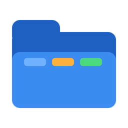
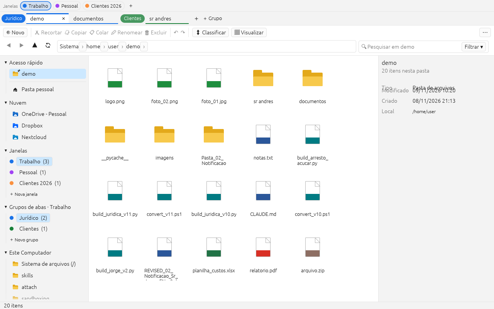

# Tabex — Explorador de Arquivos com Janelas e Grupos de Abas

Gerenciador de arquivos escrito em **Rust** ([egui](https://github.com/emilk/egui)/eframe), inspirado no
Explorador de Arquivos do Windows 11, com três níveis de organização: **janelas → grupos de abas → abas**,
todos com nome e cor, para organizar tudo o que você tem aberto.


<details>
<summary>Tema escuro e visualização em ícones com painel de visualização</summary>



</details>

## Instalação no Windows (C:\tabex)

1. Baixe [`instalar.bat`](installer/instalar.bat) (botão "Raw" → salvar) e execute com dois cliques.
2. Ele baixa a release mais recente do GitHub, instala em **`C:\tabex`**, cria atalhos no Menu Iniciar e na
   Área de Trabalho e adiciona a pasta ao PATH. Não precisa de administrador.
3. Para atualizar depois: rode `C:\tabex\atualizar.bat` **ou** use "⋯ › Atualizações" dentro do Tabex, que
   baixa e instala a nova versão sozinho (o próprio executável se substitui e pede para reiniciar).

O Tabex também verifica novas versões sozinho ao iniciar, uma vez por dia; quando há uma, aparece um aviso
"⬆ Atualizar para vX" na barra de status. Antes de instalar, o pacote baixado é conferido contra o
`SHA256SUMS.txt` publicado na release (se não bater, nada é alterado), e o executável anterior fica guardado
como `tabex.exe.bak`; o diálogo de atualizações tem "Restaurar versão anterior" caso algo dê errado.

> **Repositório privado?** Salve um token do GitHub com permissão de leitura de releases em
> `C:\tabex\github_token.txt` (ou na variável de ambiente `TABEX_GITHUB_TOKEN`). O instalador e o
> atualizador interno usam esse token. Se houver um `tabex-windows-x64-*.zip` ao lado do `instalar.bat`,
> ele é usado sem acessar a internet.

**Configurações por computador.** Instalado em `C:\tabex` (ou em qualquer pasta gravável fora de
Program Files), o Tabex roda em **modo portátil**: janelas, grupos, abas, pastas fixadas e preferências
ficam em `C:\tabex\session.json`, separadas em cada máquina. Fora desse caso ele usa a pasta do usuário
(tabela no fim deste arquivo).

## Recursos

**Janelas, grupos e abas**
- **Janelas** (barra superior): espaços de trabalho com nome e cor, cada um com seus próprios grupos de abas.
  Troque com um clique, Ctrl+Alt+PgDn/PgUp ou Ctrl+Alt+1…9. Arraste uma aba até uma janela para movê-la;
  mova grupos inteiros pelo menu de contexto.
- Grupos de abas com **nome e cor** (9 cores); clique no rótulo do grupo para recolher/expandir.
- Abas de navegação independentes (histórico, ordenação e agrupamento por aba).
- Arraste abas entre grupos ou para reordenar; arraste até "＋ Grupo" para criar um grupo novo.
- Menu de contexto na aba: duplicar, mover para grupo/janela, fechar outras, fechar à direita.
- Reabrir aba fechada (Ctrl+Shift+T). A sessão é salva automaticamente.

**Visualização e arquivos**
- Modos **Detalhes** e **Ícones grandes** (Ctrl+Shift+6 / Ctrl+Shift+2) com miniaturas de imagens; no Windows, ícones reais do sistema por tipo de arquivo e miniaturas do shell (inclusive PDF).
- **Painel de visualização** (Alt+P): imagem, texto (txt, código, csv…), informações do item; miniatura de PDF no Windows.
- **Arrastar e soltar**: arraste arquivos para pastas da lista, para abas, grupos, janelas e para o painel lateral (move no mesmo disco, copia entre discos; Ctrl copia, Shift move). Solte arquivos vindos do Explorer na lista para copiar (Shift move). No Windows, arraste do Tabex para o Explorer, Outlook e outros programas.
- Renomear **direto na lista** (F2), seleção por **retângulo** arrastando no vazio, listagem de pastas grandes em segundo plano, atualização instantânea quando a pasta muda (notify).
- Ao colar sobre nomes existentes, o Tabex pergunta: **Substituir, Pular ou Manter ambos**; operações podem ser **canceladas** e entram numa **fila** (uma por vez).
- Pesquisa **dentro dos arquivos** (menu Filtrar › "Pesquisar dentro dos arquivos" ou prefixo `conteudo:palavra`), limitada a arquivos de texto até 20 MB.
- **Janelas separadas**: no menu de uma janela, "Abrir em janela separada" cria uma janela real do sistema com aquele espaço de trabalho (para dois monitores, por exemplo); "Trazer de volta" reanexa.

**Nuvem e menu nativo**
- Painel lateral com a seção **Nuvem**: detecta automaticamente OneDrive (pessoal e comercial), Dropbox
  (pessoal e business), Nextcloud, ownCloud, Google Drive e iCloud Drive pelas configurações dos clientes
  de sincronização.
- No Windows, o botão direito abre o **mesmo menu de contexto do Explorador** (Abrir com, Enviar para,
  Compartilhar, 7-Zip, Git etc.), com os itens do Tabex no topo (abrir em nova aba/grupo/janela, fixar).
  Pode ser desligado em "Visualizar › Menu de contexto do Windows" para usar o menu interno.

**Navegação igual ao Explorer**
- Barra de endereços em *breadcrumb* com menu "›" de subpastas; clique no espaço vazio ou Ctrl+L para digitar o caminho (`~`, `%USERPROFILE%` e `$HOME` são expandidos).
- Voltar / Avançar / Subir, painel de navegação com Acesso rápido (pastas fixadas), Grupos de abas e Este Computador (unidades).
- Lista em detalhes: Nome, Data de modificação, Tipo, Tamanho (em KB, como o Explorer), colunas redimensionáveis e clicáveis para ordenar.
- **Agrupar por** data de modificação (Hoje, Ontem, Semana passada, Mês passado…) ou por tipo.
- Digitação rápida para pular até o item, seleção com Shift/Ctrl, Ctrl+A.
- Atualização automática quando a pasta muda no disco.

**Pesquisa e filtros**
- Caixa de pesquisa filtra a pasta enquanto você digita; **Enter** pesquisa recursivamente nas subpastas em segundo plano (coluna extra "Pasta" nos resultados).
- Curingas como no Explorer: `*.pdf`, `*.exe`, `relat*`, `foto_??.jpg`.
- Prefixos: `ext:pdf,docx` · `tipo:pasta` / `tipo:arquivo` / `tipo:imagem` / `tipo:codigo` … · `tamanho:>1mb` / `tamanho:<500kb` · `data:hoje` / `data:semana` / `data:mes`.
- Menu **Filtrar**: por tipo (pastas, documentos, imagens, vídeos…), data de modificação e faixas de tamanho (Vazio, Minúsculo, Pequeno, Médio, Grande…), iguais aos do Explorer.

**Operações de arquivo**
- Recortar, copiar, colar (cópia na mesma pasta gera "Nome - Cópia"), renomear (F2, seleciona o nome sem a extensão), nova pasta, novo documento de texto.
- **Desfazer / refazer (Ctrl+Z / Ctrl+Y)** para mover, copiar, renomear, criar e excluir para a Lixeira (restaura da Lixeira). Os botões ↶ ↷ da barra mostram o que será desfeito.
- **Área de transferência integrada ao Windows**: copie no Tabex e cole no Explorer (ou no Outlook), copie no Explorer e cole no Tabex; recortar é respeitado nos dois sentidos (CF_HDROP + Preferred DropEffect).
- Excluir para a **Lixeira** (Delete) ou permanentemente (Shift+Delete), com confirmação.
- Operações longas rodam em segundo plano com barra de progresso na barra de status.
- Abrir com o aplicativo padrão (Enter / duplo clique), copiar caminho, fixar no Acesso rápido, Propriedades (tamanho de pastas calculado em segundo plano).
- Mostrar itens ocultos (Ctrl+H), tema claro/escuro.

## Atalhos principais

| Atalho | Ação |
|---|---|
| Ctrl+T / Ctrl+W | Nova aba / fechar aba |
| Ctrl+Shift+T | Reabrir aba fechada |
| Ctrl+Tab, Ctrl+Shift+Tab, Ctrl+1…9 | Alternar abas |
| Ctrl+Shift+PgUp / PgDn | Mover aba |
| Ctrl+G / Ctrl+Shift+G | Novo grupo / editar grupo atual |
| Ctrl+Alt+← / → | Grupo anterior / próximo |
| Ctrl+Alt+T / Ctrl+Alt+W | Nova janela / fechar janela |
| Ctrl+Alt+PgDn / PgUp, Ctrl+Alt+1…9 | Alternar janelas |
| Ctrl+Alt+G | Renomear / cor da janela atual |
| Alt+← / Alt+→ / Alt+↑ / Backspace | Voltar / avançar / subir / voltar |
| F5, Ctrl+R | Atualizar |
| Ctrl+L, Alt+D, F4 | Barra de endereços |
| Ctrl+E, Ctrl+F, F3 | Pesquisa |
| Ctrl+C / X / V, Delete, Shift+Delete, F2 | Copiar / recortar / colar, excluir, renomear |
| Ctrl+Z / Ctrl+Y | Desfazer / refazer |
| Ctrl+Shift+N | Nova pasta |
| Ctrl+Shift+C | Copiar caminho |
| Ctrl+D | Fixar / desafixar pasta atual |
| Ctrl+H / Ctrl+B | Itens ocultos / painel de navegação |
| Alt+Enter | Propriedades |
| F1 | Lista completa de atalhos |

## Compilar e executar

Requer [Rust](https://rustup.rs) estável (1.85+).

```bash
cargo run --release
```

O executável fica em `target/release/tabex` (`tabex.exe` no Windows). No Windows não é necessária
nenhuma dependência extra. No Linux (Debian/Ubuntu) instale antes:

```bash
sudo apt-get install -y libxkbcommon-dev libwayland-dev libxcb-render0-dev libxcb-shape0-dev libxcb-xfixes0-dev libgtk-3-dev
```

Testes (unitários e de interface com `egui_kittest`, sem GPU):

```bash
cargo test
```

O workflow em `.github/workflows/build.yml` roda testes, clippy e gera binários para Windows, Linux e macOS;
uma tag `v*` publica os zips em uma Release do GitHub.

## Onde a sessão é salva

| Situação | Arquivo |
|---|---|
| Windows, instalado em `C:\tabex` (portátil) | `C:\tabex\session.json` |
| Windows, outros casos | `%APPDATA%\tabex\session.json` |
| Linux | `~/.config/tabex/session.json` |
| macOS | `~/Library/Application Support/tabex/session.json` |

## Estrutura do código

```
src/
  main.rs            ponto de entrada (eframe)
  app.rs             estado do aplicativo, fila de ações e loop de UI
  shortcuts.rs       tabela de atalhos de teclado
  update.rs          verificação/instalação de atualizações (releases do GitHub)
  model/             sessão persistida: janelas, grupos, abas, cores
  fs/                listagem, tipos, filtros/consulta, pesquisa recursiva (nome e conteúdo), operações (desfazer, conflitos, fila), nuvem, área de transferência, miniaturas
  platform/          menu de contexto do shell do Windows (IContextMenu) e arrastar para fora (OLE)
  ui/                janelas, abas, barra de ferramentas, painel lateral, lista/grade, visualização, status, diálogos, tema, ícones, arrastar e soltar
tests/               testes de interface (egui_kittest)
installer/           instalar.bat / atualizar.bat (C:\tabex)
assets/              ícone (pasta azul) e gerador
```

## Roteiro

- Usar o índice do Windows Search na pesquisa
- Miniaturas de vídeo e de documentos fora do Windows
- Arrastar arquivos entre janelas separadas

## Licença

MIT
