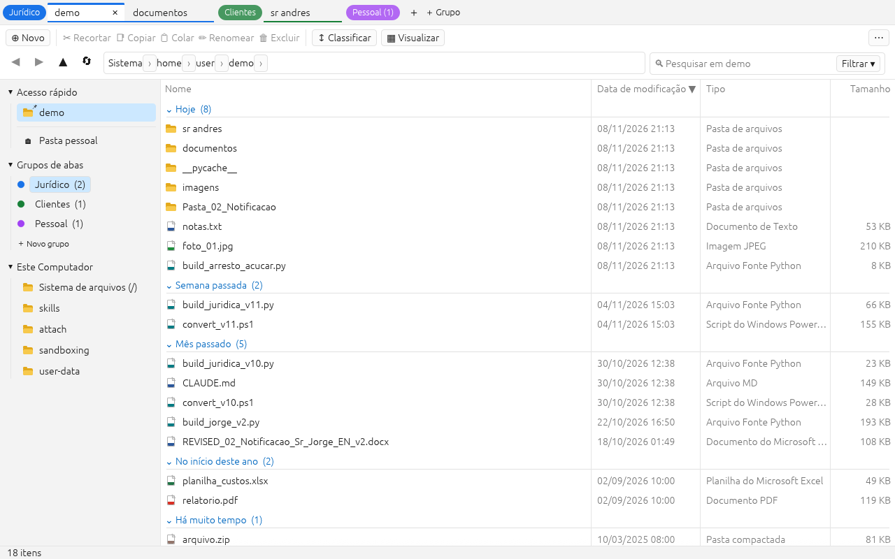
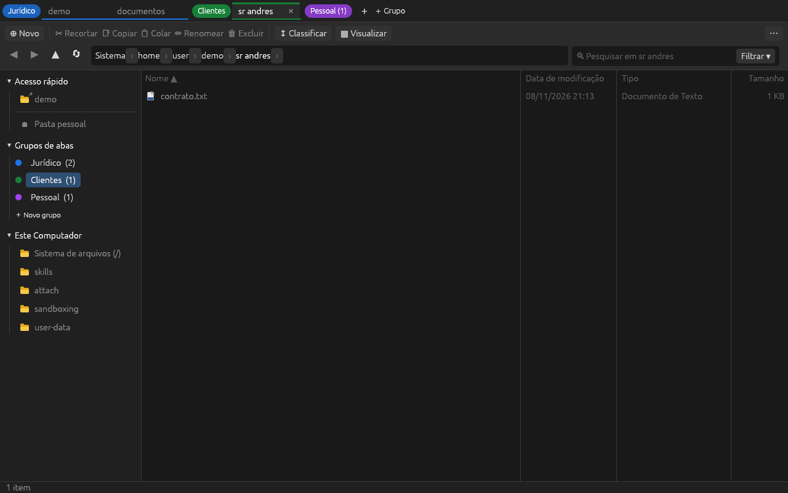

# Tabex — Explorador de Arquivos com Grupos de Abas

Gerenciador de arquivos escrito em **Rust** ([egui](https://github.com/emilk/egui)/eframe), inspirado no
Explorador de Arquivos do Windows 11, com um diferencial: **grupos de abas coloridos** para organizar
o trabalho (como os grupos de abas do Chrome).



<details>
<summary>Tema escuro</summary>


</details>

## Recursos

**Abas e grupos**
- Abas de navegação independentes (histórico, ordenação e agrupamento por aba).
- Grupos de abas com **nome e cor** (9 cores); clique no rótulo do grupo para recolher/expandir.
- Arraste abas entre grupos ou para reordenar; arraste até "＋ Grupo" para criar um grupo novo.
- Menu de contexto na aba: duplicar, mover para grupo, fechar outras, fechar à direita.
- Reabrir aba fechada (Ctrl+Shift+T). A sessão (grupos, abas, fixados, tema) é salva automaticamente.

**Navegação igual ao Explorer**
- Barra de endereços em *breadcrumb* com menu "›" de subpastas; clique no espaço vazio ou Ctrl+L para digitar o caminho (`~`, `%USERPROFILE%` e `$HOME` são expandidos).
- Voltar / Avançar / Subir, painel de navegação com Acesso rápido (pastas fixadas), Grupos de abas e Este Computador (unidades).
- Lista em detalhes: Nome, Data de modificação, Tipo, Tamanho (em KB, como o Explorer), colunas redimensionáveis e clicáveis para ordenar.
- **Agrupar por** data de modificação (Hoje, Ontem, Semana passada, Mês passado…) ou por tipo.
- Digitação rápida para pular até o item, seleção com Shift/Ctrl, Ctrl+A.
- Atualização automática quando a pasta muda no disco.

**Pesquisa e filtros**
- Caixa de pesquisa filtra a pasta enquanto você digita; **Enter** pesquisa recursivamente nas subpastas em segundo plano (coluna extra "Pasta" nos resultados).
- Prefixos: `ext:pdf,docx` · `tipo:pasta` / `tipo:arquivo` / `tipo:imagem` / `tipo:codigo` … · `tamanho:>1mb` / `tamanho:<500kb` · `data:hoje` / `data:semana` / `data:mes`.
- Menu **Filtrar**: por tipo (pastas, documentos, imagens, vídeos…), data de modificação e faixas de tamanho (Vazio, Minúsculo, Pequeno, Médio, Grande…), iguais aos do Explorer.

**Operações de arquivo**
- Recortar, copiar, colar (cópia na mesma pasta gera "Nome - Cópia"), renomear (F2, seleciona o nome sem a extensão), nova pasta, novo documento de texto.
- Excluir para a **Lixeira** (Delete) ou permanentemente (Shift+Delete), com confirmação.
- Operações longas rodam em segundo plano com barra de progresso na barra de status.
- Abrir com o aplicativo padrão (Enter / duplo clique), copiar caminho, fixar no Acesso rápido, Propriedades (tamanho de pastas calculado em segundo plano).
- Mostrar itens ocultos (Ctrl+H), tema claro/escuro.

## Atalhos principais

| Atalho | Ação |
|---|---|
| Ctrl+T / Ctrl+W | Nova aba / fechar aba |
| Ctrl+Shift+T | Reabrir aba fechada |
| Ctrl+Tab, Ctrl+Shift+Tab, Ctrl+1…9 | Alternar abas |
| Ctrl+Shift+PgUp / PgDn | Mover aba |
| Ctrl+G / Ctrl+Shift+G | Novo grupo / editar grupo atual |
| Ctrl+Alt+← / → | Grupo anterior / próximo |
| Alt+← / Alt+→ / Alt+↑ / Backspace | Voltar / avançar / subir / voltar |
| F5, Ctrl+R | Atualizar |
| Ctrl+L, Alt+D, F4 | Barra de endereços |
| Ctrl+E, Ctrl+F, F3 | Pesquisa |
| Ctrl+C / X / V, Delete, Shift+Delete, F2 | Copiar / recortar / colar, excluir, renomear |
| Ctrl+Shift+N | Nova pasta |
| Ctrl+Shift+C | Copiar caminho |
| Ctrl+D | Fixar / desafixar pasta atual |
| Ctrl+H / Ctrl+B | Itens ocultos / painel de navegação |
| Alt+Enter | Propriedades |
| F1 | Lista completa de atalhos |

## Compilar e executar

Requer [Rust](https://rustup.rs) estável (1.85+).

```bash
cargo run --release
```

O executável fica em `target/release/tabex` (`tabex.exe` no Windows). No Windows não é necessária
nenhuma dependência extra. No Linux (Debian/Ubuntu) instale antes:

```bash
sudo apt-get install -y libxkbcommon-dev libwayland-dev libxcb-render0-dev libxcb-shape0-dev libxcb-xfixes0-dev libgtk-3-dev
```

Testes:

```bash
cargo test
```

O workflow em `.github/workflows/build.yml` roda testes, clippy e gera binários para Windows, Linux e macOS;
uma tag `v*` publica os zips em uma Release do GitHub.

## Onde a sessão é salva

| Sistema | Arquivo |
|---|---|
| Windows | `%APPDATA%\tabex\session.json` |
| Linux | `~/.config/tabex/session.json` |
| macOS | `~/Library/Application Support/tabex/session.json` |

## Estrutura do código

```
src/
  main.rs            ponto de entrada (eframe)
  app.rs             estado do aplicativo, fila de ações e loop de UI
  shortcuts.rs       tabela de atalhos de teclado
  model/             sessão persistida: grupos, abas, cores
  fs/                listagem, tipos, filtros/consulta, pesquisa recursiva, operações
  ui/                barra de abas, barra de ferramentas, painel lateral, lista, status, diálogos, tema, ícones
```

## Roteiro

- Visualizações em ícones grandes/miniaturas
- Painel de visualização (preview) de imagens e texto
- Desfazer (Ctrl+Z) para mover/renomear
- Arrastar e soltar arquivos entre abas
- Ícones nativos do sistema para tipos de arquivo

## Licença

MIT
